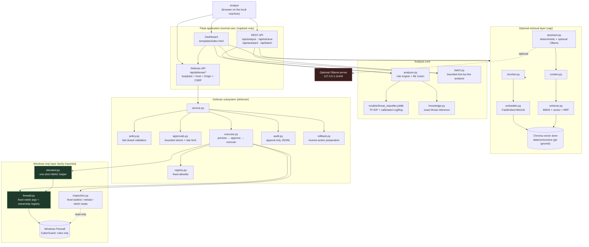
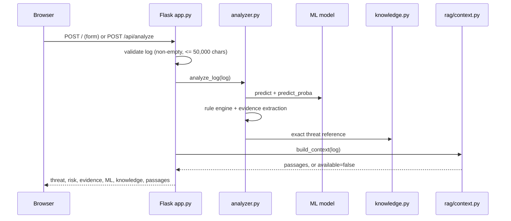
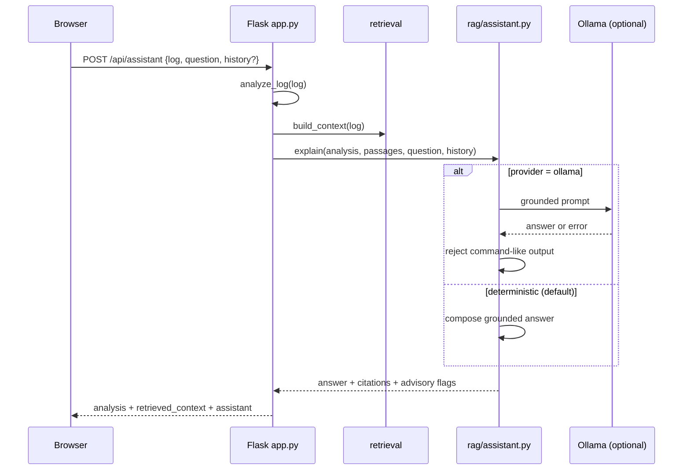
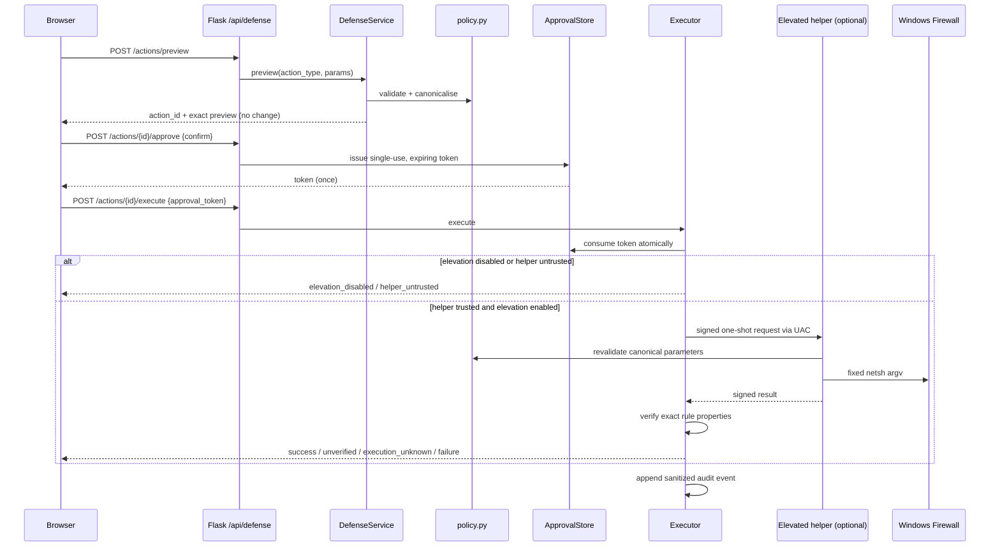

# CyberGuard AI — Architecture

CyberGuard AI is a **local, single-user defensive assistant**. It is not a
service, not an enterprise EDR and not an antivirus replacement. The diagram
below shows the actual module boundaries in this repository.

## System overview

## Request paths

### 1. Log analysis

The ML prediction is **probabilistic** and is shown as one signal, not as
confirmation. Risk is a rule-based triage label.

### 2. Assistant question

The assistant has no tools, no approval capability and no execution path. Its
result explicitly reports `advisory_only: true`, `can_approve: false` and
`can_execute: false`.

### 3. Defensive action (state-changing)

There is deliberately no endpoint that executes an action from an
`action_type` + `params` pair. Preview, approval and execution are separate
requests, and the approval token is never rendered in the UI or written to the
audit log.

## Trust boundaries

| Boundary | What is trusted | What is not |
| --- | --- | --- |
| Browser → Flask | Loopback client, strict Host, same-origin, session CSRF | Any remote client; cross-site requests |
| Log / knowledge text | Nothing — rendered with `textContent` / Jinja autoescape | Any HTML or script in the input |
| Assistant | Deterministic grounded composer | The LLM: no tools, no approval, command-like output rejected |
| Defense API | Canonical parameters produced by `policy.py` | Arbitrary action types, extra keys, client-supplied rule names |
| Elevated helper | Administrator-protected helper root + verified ACL | Repository checkout, ordinary venv, bare path |
| Windows commands | Fixed argv lists via trusted `System32` paths | Shell strings, PATH lookup, user-supplied executables |
| Audit log | Append-only through the app | Tamper-proof storage (same-user/admin can edit) |

## Failure behaviour

- Missing RAG dependencies or vector store → retrieval `available: false`; the
  rest of the analysis still works.
- Ollama unavailable, slow or malformed → deterministic answer, with the reason
  recorded in `assistant.error`.
- LLM answer that looks like a shell command → refused; deterministic answer
  returned.
- Analyzer failure → generic 500 for the API, an inline error on the dashboard;
  no traceback is returned to the browser.
- Elevation disabled or helper untrusted → fail closed with a stable error
  category.
- Timeout during elevated execution → `execution_unknown`; never success and
  never retried automatically.
- Corrupt rule ownership registry → fail closed and report it; never silently
  replaced.

## Related documents

- [Windows VM testing procedure](windows-vm-testing.md)
- [Performance measurements](performance.md)
